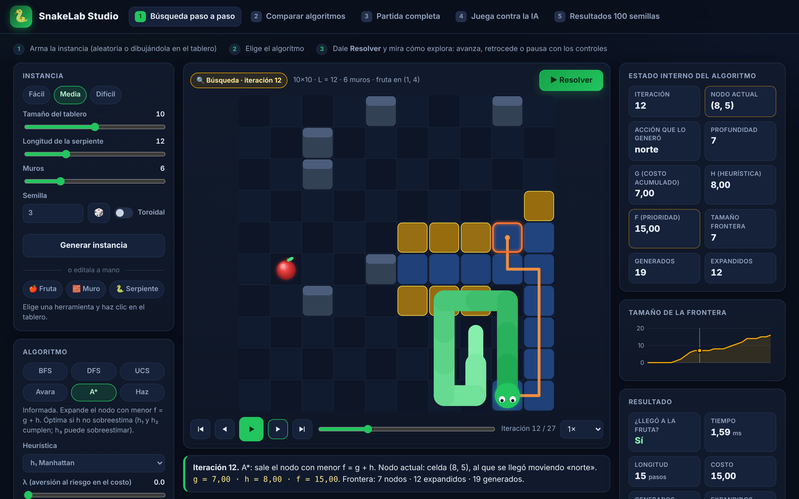
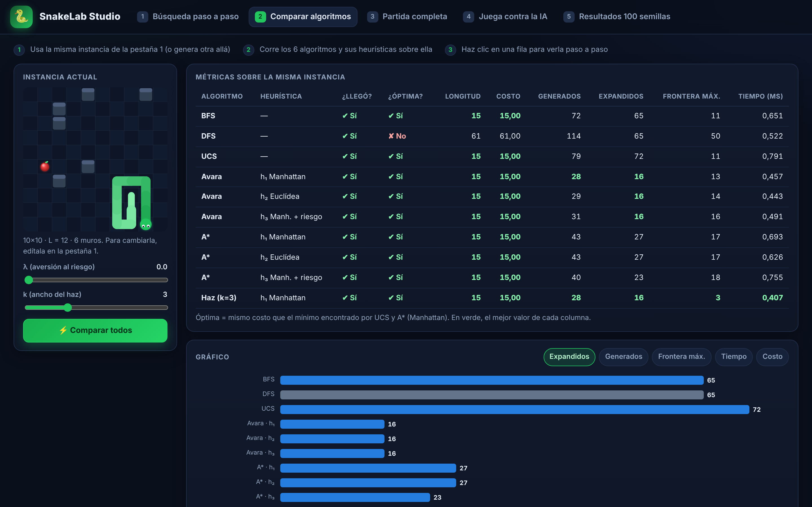
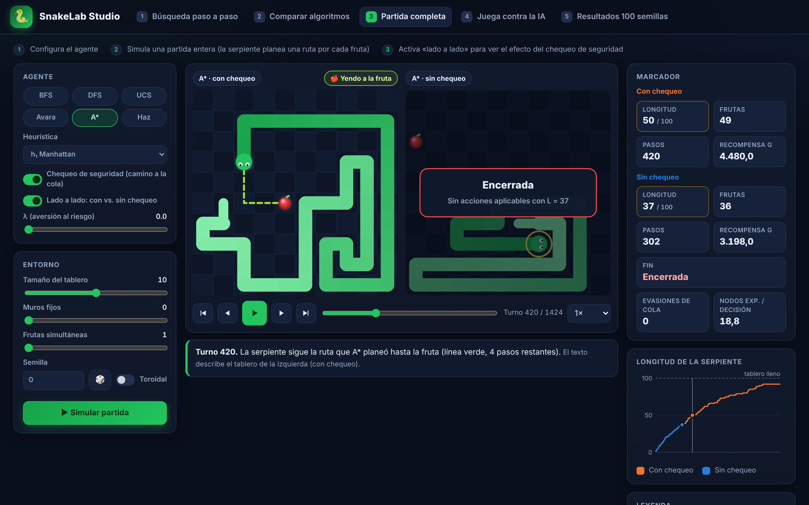
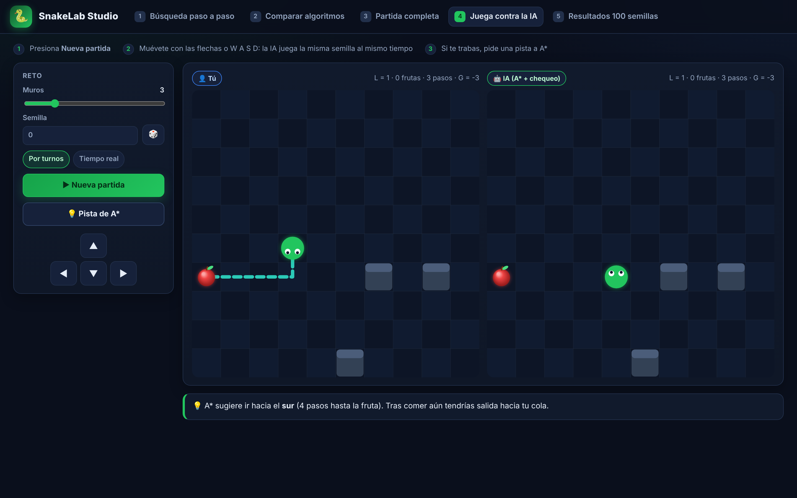
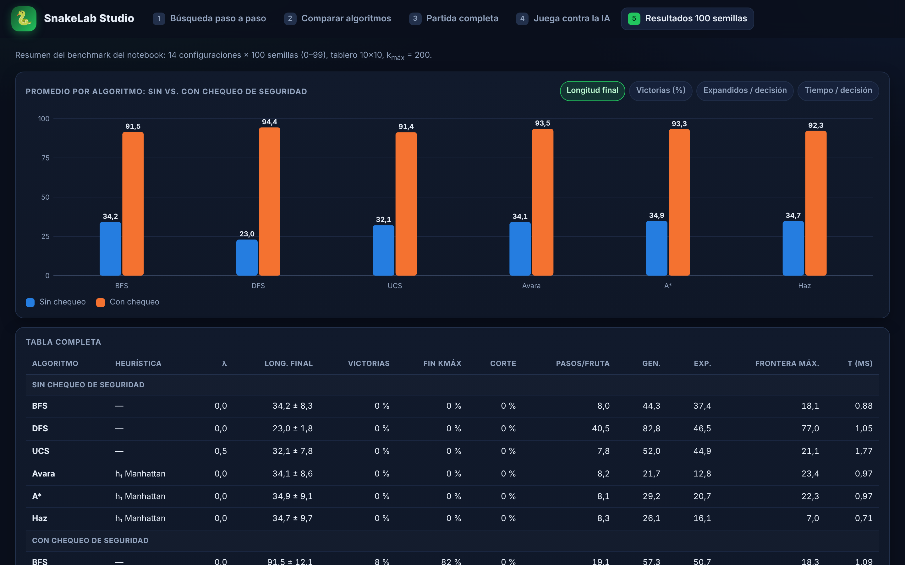

# Proyecto Final: Agente de Búsqueda Heurística para Snake
**Asignatura:** Representación y Solución Automática de Problemas
**Programa:** Matemáticas Aplicadas y Ciencias de la Computación (MACC) - Universidad del Rosario
**Autores:** Daniel José Morales y Juan Esteban Torres

---

## 1. Descripción General
Este proyecto modela y resuelve el juego **Snake** descomponiendo una partida secuencial y estocástica (por la aparición aleatoria de cada fruta) en una secuencia de **subproblemas deterministas de búsqueda en grafo** resueltos por un **agente basado en objetivos y basado en modelo (Model-Based)**.

Para evitar que el agente se encierre con su propio cuerpo a medida que crece, se incorpora un **Chequeo de Seguridad** mediante un segundo problema de búsqueda que verifica la existencia de un camino válido desde la cabeza hasta la cola ($c_L$) tras simular el consumo de la fruta, acompañado de una función de pérdida sensible al riesgo $c(s, a, s') = 1 + \lambda r(h')$.

---

## 2. Estructura del Repositorio
* `ambientes.py`: Define el estado inmutable `EstadoSnake`, el espacio de estados `SubproblemaSnake`, el entorno secuencial `Snake` y el juego bipersonal `SnakeJuegoAdversario`.
* `busqueda.py`: Implementa `ListaPrioritaria`, `Nodo`, `nodo_hijo`, las 3 funciones heurísticas (`heuristica_manhattan`, `heuristica_euclidea`, `heuristica_riesgo`) y los 6 algoritmos en grafo (`anchura`, `profundidad`, `dijkstra`, `avara`, `a_estrella`, `busqueda_haz`) con captura de trazas paso a paso.
* `agentes.py`: Contiene la clase base `Agent`, el agente principal `AgenteSnake` (con chequeo de seguridad y seguimiento de cola) y `AgenteFrutaAdversaria` (Minimax con poda Alfa-Beta).
* `utils.py`: Incluye las clases `Episode`, `Plot`, `Experiment`, `EnvfromGameAndPl2`, `ExperimentEspacios`, el benchmark reproducible de las 100 semillas ($0 \dots 99$), las funciones de graficación de resultados y los paneles anteriores en `ipywidgets` (reemplazados por SnakeLab Studio).
* `interfaz.py`: Aplicación gráfica **SnakeLab Studio**. Levanta un servidor HTTP local dentro del kernel y expone una API JSON que llama a `ambientes.py`, `busqueda.py` y `agentes.py`.
* `web/`: Página de SnakeLab Studio (`index.html`, `app.js`, `estilos.css`), que dibuja el tablero en un canvas y anima las búsquedas paso a paso.
* `resultados_benchmark_100_semillas.csv`: Resultados guardados del experimento sobre las semillas $0 \dots 99$.
* `capturas/`: Capturas de pantalla de la aplicación.
* `Snake_Proyecto_Final.ipynb`: Notebook principal de presentación y experimentación.

---

## 3. Instalación y Ejecución
Requiere **Python 3.12** (versión compatible con todas las dependencias).

1. Clonar el repositorio o, en Google Colab, copiar la carpeta a `MyDrive/Proyecto Representación`.
2. Instalar las dependencias:
   ```bash
   pip install -r requirements.txt
   ```
3. Abrir `Snake_Proyecto_Final.ipynb` y ejecutar todas las celdas (*Reiniciar y ejecutar todo*). El notebook detecta si corre en Colab (monta Google Drive) o en Jupyter / VS Code local (usa la carpeta del notebook).
4. La celda de la Sección 2 muestra un enlace que abre **SnakeLab Studio** en otra pestaña del navegador. También se puede abrir sin el notebook:
   ```bash
   python interfaz.py
   ```
   y luego entrar a `http://localhost:8050`.

---

## 4. Capturas de SnakeLab Studio

### Búsqueda paso a paso
Editor de instancias y reproducción de la búsqueda: nodos expandidos, frontera, nodo actual y $f(n) = g(n) + h(n)$ en cada iteración.



### Comparar algoritmos
Los 6 algoritmos y las 3 heurísticas sobre la misma instancia, con sus métricas.



### Partida completa: con vs. sin chequeo de seguridad


### Juega contra la IA


### Resultados de las 100 semillas

